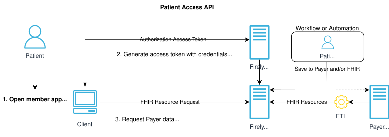
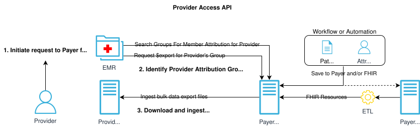
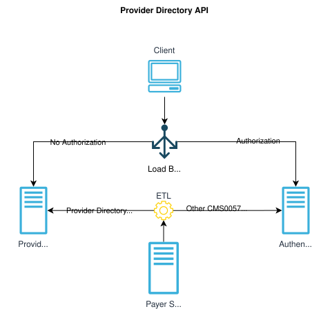

.. _cms:

CMS Interoperability and Prior Authorization Final Rule (CMS-0057-F) - 🇺🇸
=========================================================================

.. |PATACC| replace:: Patient Access API
.. |PROACC| replace:: Provider Access API
.. |PRODIR| replace:: Provider Directory API
.. |PRTOPR| replace:: Payer-to-Payer API
.. |PRAUTH| replace:: Prior Authorization API
.. |CARIN|  replace:: CARIN for Blue Button® IG Version STU 2.0.0
.. |SMART|  replace:: SMART App Launch IG Release 2.0.0 support Backend Services
.. |PDXIG|  replace:: Da Vinci Payer Data Exchange (PDex) IG Version STU 2.2.0
.. |PDRIG|  replace:: Da Vinci PDex US Drug Formulary IG Version STU 2.0.1
.. |PNTIG|  replace:: Da Vinci PDex Plan-Net IG Version STU 1.1.0
.. |CRDIG|  replace:: Da Vinci Coverage Requirements Discovery (CRD) IG Version STU 2.0.1
.. |CRDIG221|  replace:: Da Vinci Coverage Requirements Discovery (CRD) IG Version STU 2.2.1
.. |DTRIG|  replace:: Da Vinci Documentation Templates and Rules (DTR) IG Version STU 2.0.0
.. |PASIG|  replace:: Da Vinci Prior Authorization Support (PAS) IG Version STU 2.0.1

The proposed `CMS Interoperability Rule (CMS-0057-F) <https://www.federalregister.gov/documents/2024/02/08/2024-00895/medicare-and-medicaid-programs-patient-protection-and-affordable-care-act-advancing-interoperability>`_ aims to promote greater interoperability, patient access, and innovation in the healthcare industry while also improving the quality and cost-effectiveness of care. Technically these goals are supported by multiple APIs that are required to be provided:

.. important::
  Firely Server supports all mandatory requirements out-of-the-box. The following implementation guides build the foundation of the APIs mentioned below.

.. list-table:: Firely Server Compliance CMS Interoperability Mandatory IGs
   :widths: 10, 10, 10, 10, 10
   :header-rows: 1
   
   * - API
     - FHIR v4.0.1
     - :ref:`us_core_ig`
     - :ref:`smart_app_launch_ig`
     - :ref:`bulk_data_access_ig`

   * - |PATACC|
     
     - ☑️ 
     - ☑️ 
     - ☑️ 
     - Not applicable
     
   * - |PROACC|
   
     - ☑️ 
     - ☑️ 
     - ☑️ 
     - ☑️ 
     
   * - |PRODIR|
   
     - ☑️ 
     - ☑️ 
     - ☑️ 
     - Not applicable
     
   * - |PRTOPR|
   
     - ☑️ 
     - ☑️ 
     - ☑️ 
     - ☑️ 
     
   * - |PRAUTH|
   
     - ☑️ 
     - ☑️ 
     - ☑️ 
     - Not applicable

.. note::
  There are additional Implementation Guides strongly recommended by CMS. We provide guidance on how to implement these Implementation Guides with Firely Server in the sections below.

.. list-table:: Firely Server Compliance CMS Interoperability Recommended IGs
   :widths: 10, 10, 10, 10, 10, 10
   :header-rows: 1
   
   * - Implementation Guide
     - |PATACC|
     - |PROACC|
     - |PRODIR|
     - |PRTOPR|
     - |PRAUTH|

   * - |CARIN|

     - ☑️ 
     - ☑️ 
     - Not applicable
     - ☑️
     - Not applicable

   * - |SMART|
     
     - Not applicable
     - ☑️ 
     - Not applicable
     - ☑️
     - Not applicable

   * - |PDXIG|  
     
     - ☑️ 
     - ☑️ 
     - Not applicable
     - ☑️
     - Not applicable

   * - |PDRIG|  

     - ☑️
     - Not applicable 
     - Not applicable
     - Not applicable
     - Not applicable

   * - |PNTIG|

     - Not applicable
     - Not applicable
     - ☑️
     - Not applicable
     - Not applicable

   * - |CRDIG|  

     - Not applicable
     - Not applicable
     - Not applicable
     - Not applicable
     - ☑️

   * - |DTRIG|  

     - Not applicable
     - Not applicable
     - Not applicable
     - Not applicable
     - ☑️

   * - |PASIG|  

     - Not applicable
     - Not applicable
     - Not applicable
     - Not applicable
     - ☑️

|PATACC|
------------------

Impacted payers (see `CMS definition <https://www.cms.gov/priorities/key-initiatives/burden-reduction/interoperability/faqs>`_) are required to make claims, encounter and clinical data, including laboratory results available through the Patient Access API.
The goal is to make as much data available to patients as possible through the API to ensure patients have access to their data in a way that will be most valuable and meaningful to them. The following information should be provided via Patient Access API using the corresponding implementation guides:

* Claim details and encounters (see :ref:`carin_ig`)
* Clinical data incl. laboratory data (see :ref:`us_core_ig` and Da Vinci Payer Data Exchange)
* Plan Coverage and Formularies (US Drug Formulary)
* Prior Authorization Decisions (Da Vinci Payer Data Exchange)

.. note::
  The Da Vinci Payer Data Exchange Implementation Guide and the CARIN Blue Button Implementation Guide both use the ExplanationOfBenefits. 
  The main difference in usage is that the CARIN profiles make information available about a final claim, whereas PDex aims for sharing prior authorization information.
  Additional details about the prior authorization decisions can be exposed via the PAS profiles.

To implement a Patient Access API it is necessary to:
  #. Enable SMART on FHIR and point Firely Server to an authorization server managing the accounts of the patients. See :ref:`feature_accesscontrol`.
  #. Expose the Patient record with all its USCDI, CPCDS, and prior authorization data elements
  #. Configure the API clients to be allowed to be granted access (read-only) to resources on behalf of the patient. See :ref:`Configuration of API clients in Firely Auth <firely_auth_settings_clients>`.

Additionally, CMS requires to collect metrics on the usage of Patient Access API. See section I.C Patient Access API Metrics of the final rule. The API usage can be derived from AuditEvents generated by Firely Server, or from the OpenTelemetry metric ``firely.server.cms0057.patient.count``, see :ref:`feature_opentelemetry`.

|PROACC|
-------------------

Impacted payers (see `CMS definition <https://www.cms.gov/priorities/key-initiatives/burden-reduction/interoperability/faqs>`_) are required to provide information exposed via a Patient Access API to providers who have a contractual relationship with the payer and a treatment relationship with the patient.
Providers could access information for an individual patient as well as a group of information, providing further insight into the patient's care activity at the point of care.

To implement a Provider Access API (Bulk) it is necessary to:
  #. Enable SMART on FHIR and point Firely Server to an authorization server managing the accounts of the providers. See :ref:`feature_accesscontrol`.
  #. Expose the Patient records with all its USCDI, CPCDS, and prior authorization data elements
  #. Maintain a member attribution lists for providers. It is necessary to account for patients who opted out of the information sharing process. See :ref:`davinci_atr_ig`.
  #. Configure the provider API clients to be allowed to be granted access (read-only) on behalf of the provider. See :ref:`Configuration of API clients in Firely Auth <firely_auth_settings_clients>`.
  #. Create access policies to restrict access to a member attribution group based on their Taxpayer Identification Numbers (TINs) and National Provider Identifiers (NPIs). See :ref:`feature_accesscontrol_permissions`.

|PRODIR|
-------------------

Impacted payers (see `CMS definition <https://www.cms.gov/priorities/key-initiatives/burden-reduction/interoperability/faqs>`_) are required  to provide a public-facing Provider Directory API containing data on contracted providers.
The API must include provider names, addresses, phone numbers, and specialties, with updates accessible within 30 days. While CMS doesn't specify how payers should handle API access for contracted networks, they must ensure the API is publicly accessible without requiring authentication. 
MA organizations offering MA-PD plans must provide pharmacy directory data, with CMS encouraging adherence to the PDex Plan-Net Implementation Guide. Developers accessing the Provider Directory API are not required to register, and its technical standards exclude authentication protocols. 
Payers need to ensure the API and its documentation are available through a public-facing digital endpoint on their website, with restrictions only allowed for necessary security measures.

To implement a |PRODIR| it is necessary to:
  #. Deploy an instance of Firely Server without security measures.
  #. Produce FHIR resources compliant with the `Da Vinci PDex Plan-Net IG Version STU 1.1.0 <https://hl7.org/fhir/us/davinci-pdex-plan-net/STU1.1>`_ Implementation Guide for storage in the unsecured Firely Server instance.
  
    * Extract resources from an existing Firely Server instance and/or generate resources from other payer systems.
    * Execute this resource generation process routinely and ensure updates are completed within 30 days of any modifications to the source data.

|PRTOPR|
-------------------
Impacted payers (see `CMS definition <https://www.cms.gov/priorities/key-initiatives/burden-reduction/interoperability/faqs>`_) are required to provide a Payor-To-Payor API to enable care continuity and patient-centered data sharing. The API facilitates the transfer of relevant data from an old payer to a new payer, supporting better decision-making and avoiding delays in care. The following information should be provided via Payor-To-Payor API using the corresponding implementation guides:

* Claim details and encounters, excluding provider remittances and enrollee cost-sharing information (see :ref:`carin_ig`)
* Clinical data incl. laboratory data (see :ref:`us_core_ig` and Da Vinci Payer Data Exchange)
* Prior Authorization Decisions, excluding those for drugs and those that were denied (Da Vinci Payer Data Exchange)

To implement a Payor-To-Payor API it is necessary to:
  #. Enable SMART on FHIR and point Firely Server to an authorization server managing organizational access for external payors. See :ref:`feature_accesscontrol`.
  #. Expose the Patient record with all its USCDI, CPCDS, and prior authorization data elements
  #. Update the Payor-To-Payor API data within one business day of its availability. It's recommended to either :ref:`PubSub` or :ref:`tool_fsi` to ingest the resource updates.
  #. Provide an API for member-match based on demographics such that the new payor can identify their members on the current system.
  #. Limit the API access via individual resource access using the :ref:`restful`, :ref:`feature_patienteverything` or :ref:`feature_bulkdataexport` to only Patients that have been previously matched by the new payor. This can be achieved by using dynamic Access Policies. See :ref:`feature_accesscontrol_permissions`.

|PRAUTH|
-------------------
Impacted payers (see `CMS definition <https://www.cms.gov/priorities/key-initiatives/burden-reduction/interoperability/faqs>`_) must provide a Prior Authorization API to allow patients and providers to access key details regarding prior authorization decisions:

  #. Identify which medical items and services are covered by the payer and determine if prior authorization is required.
  #. Review the necessary information and documentation needed to submit a prior authorization request.

Additionally, payers are required to support the submission of Prior Authorization requests from providers entirely through the API and facilitate the exchange of all Prior Authorization decisions via the API.

.. note::

   See the `Electronic Prior Authorization (ePA) use case <https://fire.ly/use-case-electronic-prior-authorization-epa/>`_
   to learn more about the business requirements around the Prior Authorization API.

To implement a Prior Authorization API it is necessary to:
  #. Collect a computable representation of the details regarding which medical items and services are covered by a plan and whether prior authorization is required for them. Firely is recommending to store this information via `Clinical Quality Language (CQL) <https://fire.ly/cql/>`_.
  #. For any covered medical item or service requiring Prior Authorization, additionally create a computable overview of all documentation requirements necessary to support the decision.. Information that can not be derived from the Patients EHR/EMR record may be collected via `FHIR Structured Data Capture <https://hl7.org/fhir/uv/sdc/>`_. Note that the CMS final rule does not specify any requirements around the representation of the documentation requirements.
  #. Allow providers to securely submit all required documentation alongside a `Claim <https://www.hl7.org/fhir/r4/claim.html>`_ resource and make prior authorization decisions accessible via the `ClaimResponse <https://www.hl7.org/fhir/r4/claimresponse.html>`_ resource. It is likely necessary to translate the incoming FHIR-based prior authorization request into an X12-based format for forwarding to existing decision backend systems.

.. _cms_crd:

Coverage Requirements Discovery (CRD)
^^^^^^^^^^^^^^^^^^^^^^^^^^^^^^^^^^^^^

CRD covers the first two capabilities of the Prior Authorization API. It tells a provider whether an item or service is covered, whether it needs prior authorization, and which documentation is needed. The provider gets this answer while ordering or scheduling the service. The |CRDIG| specifies how. The CRD demo service of Firely Server follows the newer |CRDIG221|. The payer runs a *CRD server*, which the EHR of the provider calls through `CDS Hooks <https://cds-hooks.hl7.org/>`_ while the order is entered. The answer is stored on the order, and carried into the documentation step (DTR) and the prior authorization request (PAS).

Firely Server serves CDS Hooks, so a payer can host its CRD server in the same Firely Server that holds its member and coverage data:

#. Enable the CDS Hooks branch, and require CRD clients to authenticate. See :ref:`feature_cds_hooks` and :ref:`feature_cds_hooks_authorization`.
#. Write the CRD service as a plugin that applies the payer's own coverage rules. Firely Server does not ship a CRD service for production use. See :ref:`vonk_reference_api_cds_hooks`.
#. Store the coverage and prior authorization rules as CQL ``Library`` resources, as recommended above, and evaluate them from the CRD service with :ref:`Library/$evaluate <feature_library_evaluate>`.
#. Resolve the provider's patient to a member with the :ref:`$member-match operation <vonk_plugins_member_match>`, and serve the documentation templates to DTR with the :ref:`$questionnaire-package operation <vonk_plugins_questionnaire_package>`.

For the hooks that CRD uses, what a CRD server returns, and the building blocks Firely Server provides, see :ref:`CRD on the CDS Hooks page <feature_cds_hooks_crd>`. Firely Server ships a CRD demo service that shows these steps working together; see :ref:`the CRD demo <feature_cds_hooks_examples_crd>`.
