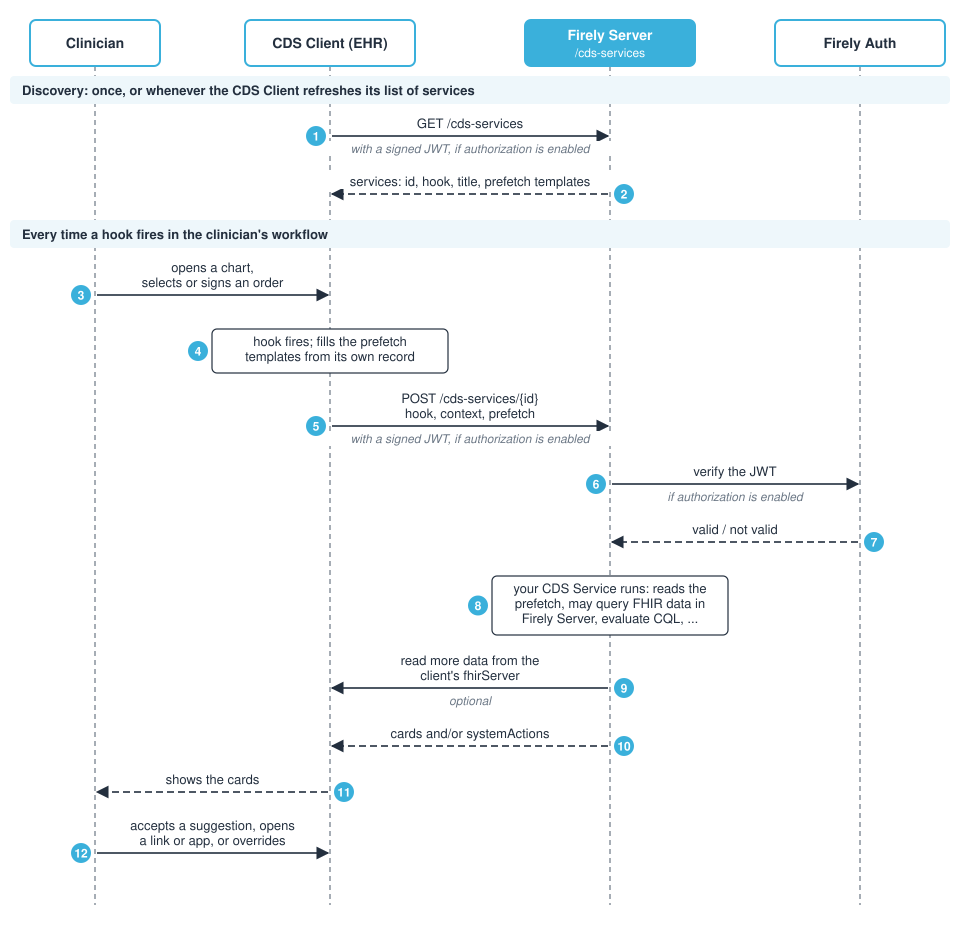

.. _feature_cds_hooks:

=========
CDS Hooks
=========

.. note::

  The features described on this page are available in the following :ref:`Firely Server editions <vonk_overview>`:

  * Firely Scale - 🌍 / 🇺🇸
  * Firely CMS Compliance - 🇺🇸

  For the implementation of CDS Hooks in earlier versions, see :ref:`feature_cds_hooks_upgrade`.

.. note::

  CDS Hooks requires the license token ``http://fire.ly/server/plugins/cds-hooks`` to be present in the license file.
  If you do not have this license token, please contact `Firely <https://fire.ly/contact>`_.

`CDS Hooks <https://cds-hooks.hl7.org/>`_ is an HL7 standard for bringing clinical decision support (CDS) into the workflow of a clinician, at the moment it is needed. When a clinician does something in an Electronic Health Record (EHR), such as opening a patient's chart or selecting an order, the EHR calls one or more external services. These services look at the patient's data and answer within moments with *cards*: short pieces of information, warnings or suggestions that the EHR shows next to the work the clinician is doing.

For example, when a physician orders an MRI of the lumbar spine, the EHR can call a CDS Service of the patient's health plan. Before the order is signed, the physician sees a card saying that the plan requires prior authorization for this MRI, with a button that opens the form to collect the documentation the plan needs. Without CDS Hooks, the practice typically learns this only afterwards, from a denied claim or a phone call.

Firely Server can host such CDS Services. It takes care of the CDS Hooks protocol, so that a service consists of nothing more than its decision logic. Because the services run inside Firely Server, they can use the FHIR data and the operations of that same server, such as the coverage rules of a health plan expressed in CQL (see :ref:`feature_qdm`).

----

CDS Hooks Use Cases
-------------------

CDS Hooks is used wherever guidance is most useful while a clinician is still making a decision, rather than in a report afterwards:

#. Coverage requirements and prior authorization

   A health plan (payer) offers a CDS Service that tells the provider, while an order is being entered, whether the item or service is covered, whether prior authorization is needed, and which documentation is required. This is the Da Vinci Coverage Requirements Discovery (CRD) use case, the first step of electronic prior authorization; see :ref:`feature_cds_hooks_crd`.

#. Medication safety

   When a medication is selected or an order is about to be signed, a CDS Service can check it against the patient's allergies, other medications, lab results or genomic data, and warn about interactions or doses that need adjusting. A card can carry the corrected order as a suggestion that the clinician accepts with a single click.

#. Care gaps and preventive care

   When a patient's chart is opened, a CDS Service can point out overdue screenings, missing vaccinations or follow-up care for a chronic condition. This is the prospective counterpart of the gaps in care that :ref:`Digital Quality Measures <feature_qdm>` find retrospectively, and both can be based on the same CQL logic.

#. Guideline adherence and appropriate use

   A CDS Service can check an order against clinical guidelines, such as the appropriate use criteria for advanced imaging, and suggest a more suitable test or record that the order was checked.

#. Launching an app when a card is not enough

   Some decisions need more interaction than a card offers, such as completing a questionnaire or using a risk calculator. A card can contain a link that launches a `SMART on FHIR <https://hl7.org/fhir/smart-app-launch/>`_ app, in the context of the current patient. In the prior authorization workflow, this is how the documentation form of Da Vinci DTR is opened.

How CDS Hooks Works
-------------------

CDS Hooks defines the interaction between two systems:

* The **CDS Client** is the EHR or other clinical information system the clinician is working in. It owns the patient record and the user interface, and decides when to call a CDS Service and how to show its answer.
* The **CDS Service** provides the decision support. It receives the patient context, applies its logic, and returns cards. Firely Server takes this role.

CDS Hooks is not a FHIR RESTful API. Its requests and responses are JSON documents of their own, but the clinical data inside them, such as the patient, the draft orders or the resources returned in a suggestion, are FHIR resources.

Hooks
^^^^^

A *hook* is a named point in the clinician's workflow at which the CDS Client calls the CDS Services that registered for it. Each hook defines its *context*: the information that the CDS Client sends along, such as the id of the patient, the user, or the orders being entered. The `CDS Hooks Library <https://cds-hooks.hl7.org/hooks.html>`_ defines the following hooks, among others:

.. list-table::
   :header-rows: 1
   :widths: 25 75

   * - Hook
     - Fires when
   * - ``patient-view``
     - The user opens a patient's record.
   * - ``order-select``
     - The user selects one or more orders, while still composing them.
   * - ``order-sign``
     - The user is about to sign one or more orders.
   * - ``order-dispatch``
     - An order is assigned to the organization or practitioner that will perform it.
   * - ``appointment-book``
     - The user is scheduling one or more appointments.
   * - ``encounter-start``
     - The user starts an encounter, such as an admission.
   * - ``encounter-discharge``
     - The user discharges the patient.
   * - ``medication-refill``
     - A refill of a medication is being processed.

The list is open: implementation guides may define hooks of their own. A CDS Service in Firely Server can answer any hook.

Discovery and prefetch
^^^^^^^^^^^^^^^^^^^^^^

A CDS Service tells CDS Clients what it offers through its *discovery* endpoint, ``GET <base-url>/cds-services``. For each service, the discovery document lists its ``id``, the ``hook`` it answers, a title and description, and optionally *prefetch templates*.

A prefetch template is a FHIR query with placeholders, such as ``Patient/{{context.patientId}}``. It names the data the service needs on every call. The CDS Client fills in the placeholders from the hook context, runs the queries against its own FHIR data, and sends the results along with the request. This saves the CDS Service a round trip for data it always needs, which matters for an answer that the clinician is waiting for.

When the prefetched data is not enough, the CDS Client may also send the address of its FHIR server, ``fhirServer``, with an access token, ``fhirAuthorization``. The CDS Service can then query the CDS Client's FHIR server for more data, with the permissions of the current user.

Cards and system actions
^^^^^^^^^^^^^^^^^^^^^^^^

A CDS Service answers with zero or more *cards*. A card has:

* a ``summary`` of one line, and optionally a longer ``detail``;
* an ``indicator`` of its urgency: ``info``, ``warning`` or ``critical``;
* a ``source``: who provides the guidance;
* optionally ``suggestions``: changes the clinician can accept, each a set of actions that create, update or delete FHIR resources in the CDS Client, such as replacing a draft order;
* optionally ``links``: a web page with more information, or a SMART app to launch;
* optionally ``overrideReasons`` the clinician can choose from when dismissing the card.

For the MRI example above, the card of the health plan could look like this:

.. code-block:: JavaScript

    {
      "cards": [
        {
          "uuid": "4e0a3a1d-8f2b-4b5e-9c7a-2d1f6b0e9a33",
          "summary": "Prior authorization required for MRI of the lumbar spine",
          "indicator": "warning",
          "source": { "label": "Example Health Plan" },
          "links": [
            {
              "label": "Complete the documentation",
              "url": "https://dtr.example.org/launch",
              "type": "smart"
            }
          ]
        }
      ]
    }

Next to cards, a response may contain *system actions*. These are changes that the CDS Client applies without showing them to the user, for example recording the outcome of the service's evaluation on a draft order. They are only appropriate where the CDS Client and the CDS Service have agreed on them beforehand.

An empty list of cards is a valid answer: the service has no guidance in this situation.

The interaction step by step
^^^^^^^^^^^^^^^^^^^^^^^^^^^^

The figure below shows the interaction between a clinician, the CDS Client and a CDS Service hosted in Firely Server.

**Discovery**

1. The CDS Client requests the discovery document from ``<base-url>/cds-services``. It does so when the service is set up, and whenever it wants to refresh its list of services.
2. Firely Server answers with the CDS Services it offers, each with its hook and prefetch templates.

**Every time a hook fires**

3. The clinician does something in the CDS Client, for example opens a patient's chart or selects an order.
4. The CDS Client recognizes the hook, finds the services registered for it, and fills in their prefetch templates from its own record.
5. The CDS Client calls each service with ``POST <base-url>/cds-services/{id}``. The request holds the ``hook``, a unique ``hookInstance``, the ``context``, the ``prefetch`` data and, optionally, ``fhirServer`` and ``fhirAuthorization``. To prove who it is, the CDS Client signs a JSON Web Token (JWT) and sends it in the ``Authorization`` header.
6. When :ref:`authorization <feature_cds_hooks_authorization>` is enabled, Firely Server has Firely Auth verify the JWT.
7. Firely Auth confirms whether the token is valid and belongs to a registered CDS Client. If not, Firely Server refuses the request.
8. The CDS Service runs. It reads the context and the prefetched data, and may query FHIR data stored in Firely Server or call operations of Firely Server, such as ``Library/$evaluate`` for logic written in CQL.
9. If the service needs data that was not prefetched, it may query the CDS Client's FHIR server, if the CDS Client provided one.
10. Firely Server answers with the cards and system actions of the service. If the service cannot answer, for example because data it needs is missing, it answers with an HTTP error status and an ``OperationOutcome``.
11. The CDS Client applies the system actions and shows the cards to the clinician.
12. The clinician acts on the cards: accepts a suggestion, opens a link or app, or dismisses a card, possibly with an override reason.

The specification also defines a *feedback* endpoint, ``POST <base-url>/cds-services/{id}/feedback``, through which the CDS Client can report which cards were accepted or overridden. Firely Server does not support feedback yet; see `Known limitations`_.

A CDS Service may answer several hooks with the same ``id``. A CDS Client can then replace the cards of an earlier call with those of a later one, as the workflow moves on, for example from ``order-select`` to ``order-sign``.

Firely Server as a CDS Service
------------------------------

Firely Server implements the server side of CDS Hooks, the CDS Service. It is not a CDS Client: it does not call other CDS Services, and it has no user interface to show cards in.

Firely Server takes care of everything that every CDS Service needs:

* the discovery endpoint and the endpoints of the services;
* reading and writing the CDS Hooks JSON, including the FHIR resources inside it;
* :ref:`authorizing CDS Clients <feature_cds_hooks_authorization>` with Firely Auth;
* optionally, :ref:`validating requests and responses <feature_cds_hooks_validation>`;
* the :ref:`audit trail <feature_auditing>` of the FHIR data a service reads.

What remains is the decision logic itself. Firely Server ships with :ref:`example services <feature_cds_hooks_examples>`, and you write your own as a plugin; see :ref:`vonk_reference_api_cds_hooks`.

A CDS Service in Firely Server can draw on two sources of data:

* **The data of the CDS Client**, sent as prefetch data or available through ``fhirServer``. This is the clinical record of the patient: conditions, medications, the draft orders.
* **The data in Firely Server itself**, read in-process through the FHIR REST pipeline. This is knowledge the CDS Client does not have, such as the organization's own records about the patient, decision rules stored as CQL ``Library`` resources, or ``Questionnaire`` resources.

Firely Server implements `CDS Hooks 3.0.0 <https://cds-hooks.hl7.org/2026Jan/>`_.

The CDS Hooks branch handles all requests in the default FHIR version of Firely Server, set in ``InformationModel:Default`` (see :ref:`feature_multiversion`). CDS Hooks is tested with **FHIR R4**, the FHIR version of Da Vinci CRD, so we recommend R4 as the default FHIR version for a deployment that serves CDS Hooks. Other FHIR versions may work, but are not tested.

Key concepts
^^^^^^^^^^^^

**CDS Hooks is served on a branch of its own.** CDS Hooks is not a FHIR RESTful API, so Firely Server serves it on a separate :ref:`pipeline branch <vonk_plugins_config>` at ``/cds-services``. That path is fixed by the specification.

**A CDS Service is identified by its id and its hook together.** Because one id may answer several hooks, as described above, each hook of a service is offered on its own.

**Nothing is offered by default.** A CDS Service receives patient data, so it has to be exposed deliberately. A service is offered only when its id and hook are named in the ``CdsHooks:Services`` section of the appsettings. A service that is installed but not named there is neither listed in the discovery document nor invoked: it answers ``404 Not Found``.

Enabling CDS Hooks
------------------

Enabling CDS Hooks takes three steps.

#. Make sure the license token ``http://fire.ly/server/plugins/cds-hooks`` is present in your :ref:`license file <configure_license>`.

#. Add a branch for ``/cds-services`` to ``PipelineOptions:Branches`` in the appsettings. List ``Vonk.Plugin.CdsHooks.Infra`` first, followed by the CDS Services you want to offer. ``Vonk.Plugin.CdsHooks.Infra`` holds everything needed to serve CDS Hooks, including authorization and validation, but it is not a service itself.

   .. code-block:: JavaScript

     "PipelineOptions": {
       "PluginDirectory": "./plugins",
       "Branches": [
         {
           "Path": "/",
           "Include": [ ... ]
         },
         {
           "Path": "/administration",
           "Include": [ ... ]
         },
         {
           "Path": "/cds-services",
           "Include": [
             "Vonk.Plugin.CdsHooks.Infra",
             "Vonk.Plugin.CdsHooks.Examples.PatientViewTestCdsServiceConfiguration"
           ]
         }
       ]
     }

   ``appsettings.default.json`` contains this branch, commented out.

#. Offer each CDS Service under ``CdsHooks:Services``, with the hooks it answers:

   .. code-block:: JavaScript

     "CdsHooks": {
       "Services": {
         "patient-view-test-hook": {
           "Hooks": {
             "patient-view": { "Enabled": true }
           }
         }
       }
     }

You can now request the discovery document:

.. code-block:: HTTP

   GET <base-url>/cds-services HTTP/1.1
   Accept: application/json

.. code-block:: JavaScript

  {
    "services": [
      {
        "hook": "patient-view",
        "id": "patient-view-test-hook",
        "title": "Test Hook",
        "description": "This is a test hook",
        "prefetch": {
          "patientToGreet": "Patient/{{context.patientId}}"
        },
        "usageRequirements": "none"
      }
    ]
  }

A few things to keep in mind about the branch:

* **Serve CDS Hooks only from its own branch.** Firely Server refuses to start when a branch serves both FHIR REST and CDS Hooks. The easiest way to cause this is to put the entry ``Vonk.Plugin.CdsHooks`` in the branch on ``/``: an ``Include`` entry also takes in every namespace below it, so that entry includes ``Vonk.Plugin.CdsHooks.Infra`` and ``Vonk.Plugin.CdsHooks.Examples`` as well. The log names the entry to use instead.
* **An** ``Include`` **entry must match a configuration class.** An entry matches a configuration class whose full name equals it, or starts with it followed by a dot. An entry that matches nothing fails startup, so a typo is reported rather than ignored.
* **The branch handles requests in** ``InformationModel:Default``. The release-prefixed form ``<base-url>/{release}/cds-services`` is not served, because a branch path is matched before the release is taken off the path. To have subdomain mapping of the FHIR version apply on this branch as well, add ``Vonk.Core.Context.Http.InformationModelEndpointConfiguration`` to its ``Include``.
* **A service reads patient data from the branch on** ``/``. When a CDS Service reads FHIR data from Firely Server, or calls an operation such as ``$member-match``, it does so through the branch that serves patient data. That is the branch on ``/``; without a branch on ``/``, it is the first branch that serves neither the administration API nor ``/cds-services``. Plugins that a CDS Service calls must be included in *that* branch, not in ``/cds-services``.

Configuring CDS Services
------------------------

All settings for CDS Hooks are in the ``CdsHooks`` section of the appsettings. The full section looks like this:

.. code-block:: JavaScript

  "CdsHooks": {
    "Services": {
      "example-service": {
        "Authorization": {
          "Enabled": true
        },
        "Hooks": {
          "patient-view": { "Enabled": true },
          "order-sign": {
            "Enabled": true,
            "RequestValidation": {
              "Enabled": false,
              "Profile": "http://fire.ly/fhir/StructureDefinition/CdsHooksRequest"
            },
            "ResponseValidation": {
              "Enabled": false,
              "Profile": "http://fire.ly/fhir/StructureDefinition/CdsHooksResponse"
            }
          }
        }
      }
    },
    "RoutedRequestHeaders": [ "x-firely-tenant" ],
    "Authorization": {
      "Enabled": false,
      "GuardDiscovery": true,
      "Authority": "",
      "ClientId": "",
      "ClientSecret": "",
      "RequireHttpsToProvider": true,
      "ReplayGuardCapacity": 100000
    }
  }

Offering a service
^^^^^^^^^^^^^^^^^^

``CdsHooks:Services:<id>:Hooks:<hook>`` offers the service with that id for that hook. Naming the hook is enough: ``"patient-view": {}`` offers it, because ``Enabled`` is ``true`` by default. Set ``Enabled`` to ``false`` to keep the entry while taking that hook of the service offline.

A pair that is not offered is left out of the discovery document and answers ``404 Not Found`` when invoked. If a service is installed but not offered, Firely Server logs the exact setting to add, for example:

.. code-block:: text

   The CDS Hooks service 'patient-view-test-hook' has a handler for hook 'patient-view' but is not offered for it,
   because it is not enabled in configuration. Add 'CdsHooks:Services:patient-view-test-hook:Hooks:patient-view' to offer it.

Both the id and the hook are case-sensitive.

.. _feature_cds_hooks_validation:

Validating requests and responses
^^^^^^^^^^^^^^^^^^^^^^^^^^^^^^^^^

Firely Server can validate the CDS Hooks payloads of a service, per hook. This is configured next to the hook, because which model a request conforms to depends on the hook. Both directions are off by default.

``RequestValidation``
    The request is validated before the service sees it. A non-conformant request is refused with ``400 Bad Request`` and an ``OperationOutcome``. This is the CDS Hooks counterpart of :ref:`prevalidation <feature_prevalidation>`.

``ResponseValidation``
    The response of the service is validated before it is sent. Issues are reported in the log, but the response is sent as the service decided.

Each has its own ``Enabled`` switch and an optional ``Profile``. Without a ``Profile``, the payload is validated against the base CDS Hooks logical model for a request or response. Set ``Profile`` to the canonical URL of a constrained model, such as the request model of a CRD hook, to hold that hook's payloads to it. Profiles other than the base models are not shipped with Firely Server; load them into the administration database yourself.

The FHIR resources inside the payload, such as the prefetched resources, are validated in the same pass.

Carrying headers to FHIR requests
^^^^^^^^^^^^^^^^^^^^^^^^^^^^^^^^^

A CDS Service may read FHIR data from Firely Server while it handles a request. That FHIR request runs inside Firely Server, through the same pipeline as a request over HTTP, so the :ref:`audit trail <feature_auditing>` applies to it. When authorization is enabled, the CDS Client is recorded as the agent on the ``AuditEvent``.

``CdsHooks:RoutedRequestHeaders`` lists the headers of the CDS request that are copied to such a FHIR request. When the setting is absent, only the tenant header is copied, so that :ref:`multi-tenancy <feature_multitenancy>` works. An empty list copies no headers at all. Most headers a CDS Client sends describe the CDS request rather than the FHIR request, and some, like ``Prefer``, would change what the FHIR request returns, so only add a header when you know why it is needed. ``Authorization`` cannot be copied; Firely Server refuses to start if it is listed.

.. note::

  Such a FHIR request is not restricted by SMART on FHIR scopes or by an AccessPolicy. A CDS Service is a plugin that runs inside Firely Server, and the code of the service states what each of its FHIR requests may access, with the authorization it passes on the call (see :ref:`vonk_reference_api_cds_hooks_fhiraccess`). Therefore:

  * Before you install a CDS Service from a third party, review its code if you can, or ask the vendor, to find out which resources it reads and writes, and with which authorization.
  * Review your own CDS Services in the same way. Each call should use the narrowest authorization that works, for example ``Authorize.ReadOnly("Patient", "Coverage")`` rather than ``Authorize.Everything()``.
  * Use the :ref:`audit trail <feature_auditing>` to check afterwards which resources a CDS Service actually accessed.

.. _feature_cds_hooks_authorization:

Authorizing CDS Clients
-----------------------

Firely Server can require CDS Clients to authenticate, as described in the section *Trusting CDS Clients* of the `specification <https://cds-hooks.hl7.org/>`_. The CDS Client signs a JWT and sends it as a bearer token in the ``Authorization`` header. Authorization is off by default.

.. warning::

  With authorization off, anyone who can reach ``/cds-services`` can invoke the CDS Services you offer, including services that return information based on patient data. Enable authorization as soon as a system that you do not trust can call your CDS Services, for example when ``/cds-services`` is reachable from outside your own network.

Prerequisite: Firely Auth
^^^^^^^^^^^^^^^^^^^^^^^^^

Firely Server does not validate the token itself. It sends the token to Firely Auth for verification, at the endpoint ``POST {authority}/connect/cdsIntrospect``. The authorization server you configure must therefore be :ref:`Firely Auth <feature_accesscontrol_idprovider>` 4.8.0 or later, which serves that endpoint. With an earlier version, every invocation is refused, and the log says that introspection failed.

Register each CDS Client in Firely Auth as a client of the type **CDS Hooks Service Client**, with the issuer of its JWTs and its public key, either as a single JWK or as a JWKS URL. Firely Auth checks the signature, the registration and the time claims of the token. Firely Server then checks:

* **The audience.** The ``aud`` of the token must be the URL of the endpoint being called: ``<base-url>/cds-services/{id}`` for an invocation, ``<base-url>/cds-services`` for discovery.
* **Replay.** Each token can be used only once. The ``jti`` of every accepted token is remembered until the token expires. A second request with the same token is refused, and so is a token without a ``jti`` or ``exp``.

A refused request is answered with ``401 Unauthorized``.

Settings
^^^^^^^^

``CdsHooks:Authorization:Enabled``
    ``false`` by default. With ``true``, every invocation of a CDS Service needs a valid token, unless the service is exempted (see below).

``CdsHooks:Authorization:GuardDiscovery``
    ``true`` by default: discovery needs a token as well, with ``<base-url>/cds-services`` as its audience. Set it to ``false`` to serve the discovery document to anyone while invocations stay guarded, for example for CDS Clients that need to read the list of services before they can obtain a token for one. The specification permits both. This setting has no effect while ``Enabled`` is ``false``.

``CdsHooks:Authorization:Authority``, ``ClientId`` and ``ClientSecret``
    The Firely Auth instance, and the credentials Firely Server introspects tokens with. When left empty, they fall back to ``SmartAuthorizationOptions:Authority``, ``SmartAuthorizationOptions:TokenIntrospection:ClientId`` and ``SmartAuthorizationOptions:TokenIntrospection:ClientSecret`` (see :ref:`feature_accesscontrol_config`). Firely Auth needs no separate client registration for this, so usually you leave these empty.

    The three fall back together, not one by one: ``ClientId`` and ``ClientSecret`` only fall back to the SMART settings when ``Authority`` is empty or equal to the SMART authority. If you set a different ``Authority``, also set its ``ClientId`` and ``ClientSecret``.

    If any of the three is missing while authorization is enabled, Firely Server refuses to start, and the log names the missing settings.

``CdsHooks:Authorization:RequireHttpsToProvider``
    Whether the authority must use ``https``. With ``true``, a non-https authority prevents Firely Server from starting. When left out, it falls back to ``SmartAuthorizationOptions:RequireHttpsToProvider`` (see :ref:`feature_accesscontrol_config`). That setting is ``true`` when absent, but ``appsettings.default.json`` sets it to ``false`` for local testing. Set it to ``true`` in production.

``CdsHooks:Authorization:ReplayGuardCapacity``
    The number of used tokens remembered to detect replay, ``100000`` by default. It must be greater than zero. See the limitations below.

To serve one service without a token while authorization is enabled, set ``Authorization:Enabled`` to ``false`` for that service:

.. code-block:: JavaScript

  "CdsHooks": {
    "Services": {
      "patient-view-test-hook": {
        "Authorization": { "Enabled": false },
        "Hooks": { "patient-view": {} }
      }
    }
  }

This switch is per service, not per hook, because the token is checked before the request body that names the hook is read. It has no effect while ``CdsHooks:Authorization:Enabled`` is ``false``. There are no scopes for CDS Services.

Limitations
^^^^^^^^^^^

* **Introspection is not cached.** Every invocation makes one call to Firely Auth. This adds the latency of one network round-trip per invocation, and CDS Hooks depends on Firely Auth being available. This is deliberate: every token can be used only once anyway, and caching a positive result would only widen the window in which a revoked token is still accepted.
* **The replay check is per instance.** The used tokens are remembered in memory. In a load-balanced deployment with several instances of Firely Server, a token replayed against another instance is not detected.
* **The replay check has a capacity.** When more than ``ReplayGuardCapacity`` unexpired tokens are remembered, the least recently used are forgotten, and such a token could be used a second time. Firely Server logs a warning when this happens, at most once every five minutes. Roughly, you need one entry per request per token lifetime: 500 requests per second with tokens valid for five minutes needs 150,000.
* **A token is used up even if the request fails.** The token is recorded as used before the service is invoked. A request that fails, for example with a ``404`` or a ``400`` from validation, still uses the token, and a CDS Client that retries with the same token gets ``401 Unauthorized``.

.. _feature_cds_hooks_crd:

Coverage Requirements Discovery (CRD)
-------------------------------------

The `Da Vinci Coverage Requirements Discovery (CRD) <https://hl7.org/fhir/us/davinci-crd/>`_ Implementation Guide is the most prominent use of CDS Hooks in the US. It defines how a health plan (payer) tells a provider, while the provider is ordering or scheduling, whether a service is covered, whether it needs prior authorization, and which documentation the plan needs. In CRD terms, the payer runs a *CRD server*, a CDS Service, and the provider's EHR is the *CRD client*, a CDS Client.

CRD is the first step of the electronic prior authorization workflow of the Da Vinci Burden Reduction guides:

#. **CRD** tells the provider, in the ordering workflow, what the plan requires.
#. **DTR** (Documentation Templates and Rules) collects the documentation the plan needs, with ``Questionnaire`` resources provided by the payer.
#. **PAS** (Prior Authorization Support) submits the prior authorization request and returns the decision.

Together they support the Prior Authorization API required by the :ref:`CMS Interoperability and Prior Authorization Final Rule (CMS-0057-F) <cms>`.

Hooks used by CRD
^^^^^^^^^^^^^^^^^

CRD uses six hooks of the CDS Hooks Library. It divides them into *primary* hooks, for which a CRD server must return coverage information, and *supporting* hooks, for which a response is optional and a CRD client may ignore it.

Primary hooks:

``appointment-book``
    Coverage of the service being booked, before the patient arrives, for example whether the location is in network.

``order-sign``
    Coverage and documentation requirements of the completed draft orders. Also used for "what if" calls, which ask about coverage without placing an order.

``order-dispatch``
    Coverage once the performer of an order is chosen, which can change the answer, for example for an out-of-network performer.

Supporting hooks:

``order-select``
    Early guidance while an order is being composed, such as a covered alternative.

``encounter-start``
    Coverage when a patient is admitted or arrives for a visit that was not booked with ``appointment-book``.

``encounter-discharge``
    Documentation and follow-up requirements at discharge.

The order hooks carry the draft orders as ``ServiceRequest``, ``MedicationRequest``, ``DeviceRequest``, ``CommunicationRequest``, ``NutritionOrder`` or ``VisionPrescription`` resources.

What a CRD server returns
^^^^^^^^^^^^^^^^^^^^^^^^^

**Coverage information.** The central answer of CRD is not a card but a system action. It updates the order or appointment in the CRD client with a ``coverage-information`` extension that states, per coverage:

* whether the service is covered, not covered, or covered under conditions;
* whether prior authorization is needed;
* whether documentation is needed, with the ``Questionnaire`` resources that DTR presents to collect it;
* a ``coverage-assertion-id`` that links the order to the payer's decision in the later DTR and PAS steps, and in the claim.

When the payer cannot find the member or an active coverage, this is not an error. The answer is coverage information saying ``not-covered``, with a reason such as ``no-member-found``, ``coverage-not-found`` or ``no-active-coverage``.

**Cards.** Next to the coverage information, a CRD server may return cards of the types CRD defines: links to external information, instructions, a proposed alternative order, additional orders, a form to complete, updated coverage records, or a SMART app to launch. Each card states its type, so that a CRD client can tell them apart.

**Configuration options.** A CRD server lists in its discovery document which types of response it can return. A CRD client switches types off per request, for example when it does not show cards for ``order-select``.

A CRD server must answer most hooks within 5 seconds, and some within 10 seconds, in 90% of the cases. Take this into account when designing the logic and the data access of a CRD service.

CRD with Firely Server
^^^^^^^^^^^^^^^^^^^^^^

A payer can host its CRD server in Firely Server, as one or more CDS Services on the ``/cds-services`` branch. Firely Server does not ship a CRD service for production use: the coverage rules are the payer's own. You write the CRD service as a plugin (see :ref:`vonk_reference_api_cds_hooks`), and offer it for each hook it answers under ``CdsHooks:Services``. Firely Server provides the building blocks:

* **The CDS Hooks protocol**, including :ref:`authorization of CRD clients <feature_cds_hooks_authorization>` and :ref:`validation <feature_cds_hooks_validation>` of requests and responses against the CRD profiles. Load the CRD Implementation Guide into the administration database and set the ``Profile`` of each hook to the matching CRD request or response profile.
* **Member and coverage data.** The payer's member, ``Coverage`` and claims data can live in the same Firely Server. A CRD service reads it in-process (see :ref:`vonk_reference_api_cds_hooks_fhiraccess`), and can use the :ref:`$member-match operation <vonk_plugins_member_match>` to find the member that the provider's ``Patient`` and ``Coverage`` refer to.
* **Coverage rules in CQL.** Rules about coverage, prior authorization and documentation can be written in CQL, stored as ``Library`` resources and evaluated with :ref:`Library/$evaluate <feature_library_evaluate>`, so that they can be changed without changing the plugin.
* **Documentation templates for DTR.** The ``Questionnaire`` resources that a coverage information refers to can be stored in Firely Server, and served to DTR with the :ref:`$questionnaire-package operation <vonk_plugins_questionnaire_package>`.

The example services ``crd-order-select-hook`` and ``crd-order-sign-hook`` show these building blocks working together, for Firely's prior authorization demo; see :ref:`the CRD demo <feature_cds_hooks_examples_crd>`.

For the other APIs that CMS-0057-F requires, and the Implementation Guides they use, see :ref:`CMS-0057-F <cms>`.

.. _feature_cds_hooks_examples:

Example CDS Services
--------------------

The plugin ``Vonk.Plugin.CdsHooks.Examples`` contains a patient-view example and a Da Vinci CRD example. Each has its own configuration class, so you can offer one without the other.

.. list-table::
   :header-rows: 1
   :widths: 25 20 55

   * - Service id
     - Hook
     - Configuration class
   * - ``patient-view-test-hook``
     - ``patient-view``
     - ``Vonk.Plugin.CdsHooks.Examples.PatientViewTestCdsServiceConfiguration``
   * - ``crd-order-select-hook``
     - ``order-select``
     - ``Vonk.Plugin.CdsHooks.Examples.CrdOrderSelectCdsServiceConfiguration``
   * - ``crd-order-sign-hook``
     - ``order-sign``
     - ``Vonk.Plugin.CdsHooks.Examples.CrdOrderSelectCdsServiceConfiguration``

Including ``Vonk.Plugin.CdsHooks.Examples`` in the branch includes both configuration classes. ``appsettings.default.json`` contains the ``CdsHooks:Services`` entries for all three service ids, commented out.

.. _feature_cds_hooks_examples_patient_view:

Patient view
^^^^^^^^^^^^

``patient-view-test-hook`` greets the patient in view with a single card. It needs no other plugins or license tokens. With the configuration from `Enabling CDS Hooks`_, you can invoke it:

.. code-block:: HTTP

    POST <base-url>/cds-services/patient-view-test-hook HTTP/1.1
    Accept: application/json
    Content-Type: application/json

    {
        "hookInstance": "d1577c69-dfbe-44ad-ba6d-3e05e953b2ea",
        "hook": "patient-view",
        "context": {
            "userId": "Practitioner/example",
            "patientId": "example"
        },
        "prefetch": {
            "patientToGreet": {
                "resourceType": "Patient",
                "id": "example",
                "name": [ { "family": "Doe", "given": [ "John" ] } ],
                "gender": "male",
                "birthDate": "1974-12-25"
            }
        }
    }

The service answers with one card:

.. code-block:: JavaScript

    {
        "cards": [
            {
                "uuid": "0a1b7c3e-4f0e-4d9a-9b0e-3f3c1a2d5e6f",
                "summary": "Hello World! Firely Server loves FHIR and CDS Hooks!",
                "detail": "Hello John Doe (male, 1974-12-25)!",
                "indicator": "info",
                "source": {
                    "label": "Firely Server",
                    "url": "<base-url>/"
                }
            }
        ]
    }

If ``patientToGreet`` is missing from the prefetch, or its id does not match ``context.patientId``, the service answers ``412 Precondition Failed`` with an ``OperationOutcome``.

.. _feature_cds_hooks_examples_crd:

Coverage Requirements Discovery demo
^^^^^^^^^^^^^^^^^^^^^^^^^^^^^^^^^^^^

``crd-order-select-hook`` and ``crd-order-sign-hook`` are the same Da Vinci Coverage Requirements Discovery (CRD) service, offered on the ``order-select`` and the ``order-sign`` hook. It reads the draft orders from ``context.draftOrders`` and answers each ``ServiceRequest`` among them: on ``order-sign`` all of them, on ``order-select`` the selected ones. The coverage information is returned as a ``systemActions`` update of the order. For a few procedure codes of the demo data, such as 72148 (MRI of the lumbar spine), it also returns guidance cards.

This service is a demonstration and not intended for production use: its coverage logic and cards are specific to Firely's prior authorization demo, and a payer implementing CRD writes coverage rules of its own. To run it, you need:

* the license token ``http://fire.ly/server/plugins/crd``, in addition to the CDS Hooks token;
* the CQL plugin and ``Vonk.Plugin.MemberMatch`` in the branch that serves patient data (the branch on ``/``), because the service calls ``$member-match`` and ``$evaluate`` there;
* the CQL libraries ``CrdExample``, ``CrdPayorContactDetails`` and ``PriorAuthQuestionnaire`` in Firely Server.

Building your own CDS Service
-----------------------------

You write your own CDS Service as a Firely Server plugin, and offer it in the same way as the examples: include its configuration class in the ``/cds-services`` branch and name it under ``CdsHooks:Services``. See :ref:`vonk_reference_api_cds_hooks` for the programming API, with a complete example.

Known limitations
-----------------

* The feedback endpoint, ``POST <base-url>/cds-services/{id}/feedback``, is recognized but answers ``501 Not Implemented``.
* ``<base-url>/{release}/cds-services`` is not served.
* See also the :ref:`limitations of authorization <feature_cds_hooks_authorization>`.

.. _feature_cds_hooks_upgrade:

Upgrading from earlier versions
-------------------------------

Earlier versions of Firely Server served CDS Hooks by mapping each CDS Hooks request onto a FHIR custom operation, in the branch on ``/``. That implementation is still shipped, as the plugin ``Vonk.Plugin.CdsHooks.Legacy``, so that an upgrade does not have to wait for the migration. It will be removed in the next major version. **Treat it as time to migrate, not as a second option to build on.**

A deployment runs either the CDS Hooks branch or the legacy plugin, never both: they claim the same route.

Staying on the legacy plugin for now
^^^^^^^^^^^^^^^^^^^^^^^^^^^^^^^^^^^^

If you upgrade without migrating yet, two changes are required.

#. **Rename the plugin in the** ``Include`` **of the branch on** ``/``. The plugin ``Vonk.Plugin.CdsHooks`` is renamed to ``Vonk.Plugin.CdsHooks.Legacy``, and its namespaces with it. Replace ``Vonk.Plugin.CdsHooks``, and any entry naming one of its namespaces such as ``Vonk.Plugin.CdsHooks.Configuration``, with the new name, for example ``Vonk.Plugin.CdsHooks.Legacy.Configuration``. The old entry would now also include the new CDS Hooks branch plugins, and Firely Server refuses to start with it.

#. **Rename two StructureDefinitions in the administration database.** The legacy plugin wraps a CDS Hooks request in a custom FHIR resource type, defined by a ``StructureDefinition`` in the administration database. Those types are renamed from ``CDSHooksRequest`` to ``CDSHooksRequestOld`` and from ``CDSHooksResponse`` to ``CDSHooksResponseOld``. Update the ``type``, ``name``, ``url`` and element paths of both definitions. Until you do, every CDS Hooks request is refused by structural validation. Nothing a CDS Client sends or receives changes.

Firely Server now uses the names ``CdsHooksRequest``, ``CdsHooksResponse``, ``CdsHooksCard``, ``CdsHooksAction``, ``CdsHooksSuggestion``, ``CdsHooksLink``, ``CdsHooksSource``, ``CdsHooksContext``, ``CdsHooksPrefetch``, ``CdsHooksPrefetchTemplates``, ``CdsHooksExtensions``, ``CdsHooksFhirAuthorization``, ``CdsHooksDiscoveryResponse`` and ``CdsHooksServiceDefinition`` itself. FHIR type names are matched case-insensitively, so a custom resource type or datatype with one of these names is refused on import, with a warning in the log at startup. Rename such a type before upgrading.

Migrating to the CDS Hooks branch
^^^^^^^^^^^^^^^^^^^^^^^^^^^^^^^^^

To move a deployment to the CDS Hooks branch:

#. Remove ``Vonk.Plugin.CdsHooks.Legacy`` from the branch on ``/``.
#. Add the ``/cds-services`` branch and the ``CdsHooks:Services`` entries, as described in `Enabling CDS Hooks`_. The example services have the same ids and hooks as the legacy ones, so CDS Clients do not need to change.
#. Remove the ``$cds-<id>`` entries from the ``Operations`` section of the appsettings. They are not used by the CDS Hooks branch.
#. You can remove the ``CDSHooksRequestOld`` and ``CDSHooksResponseOld`` StructureDefinitions from the administration database. The CDS Hooks branch takes the CDS Hooks payloads as they are.
#. Rewrite custom CDS Services against the new programming API. See the migration table in :ref:`vonk_reference_api_cds_hooks`.
