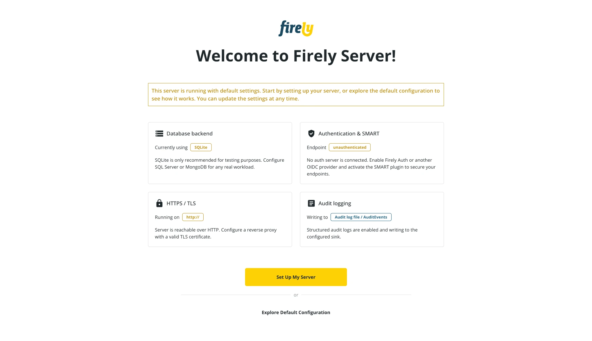
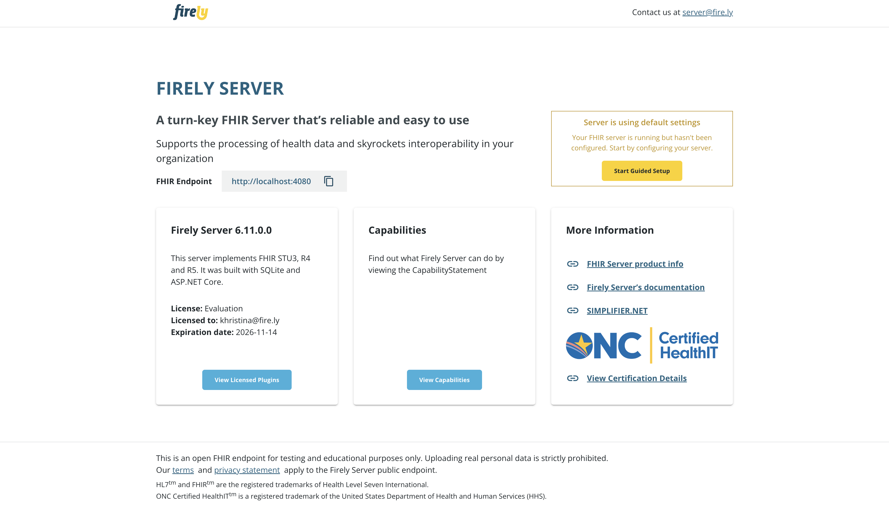
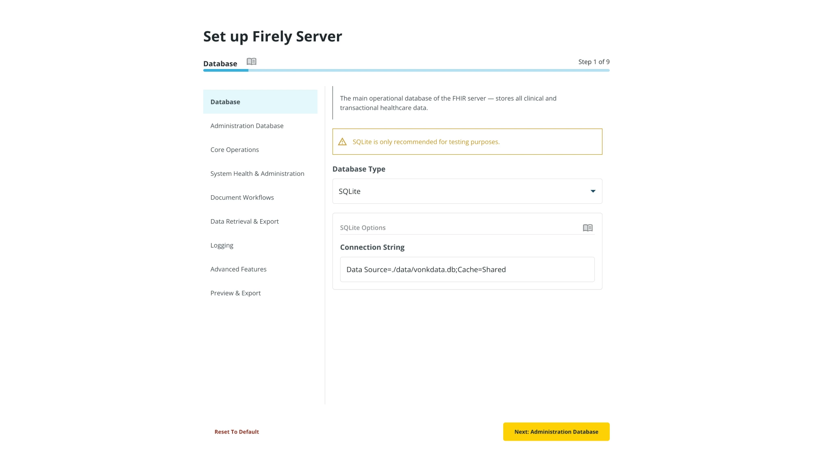
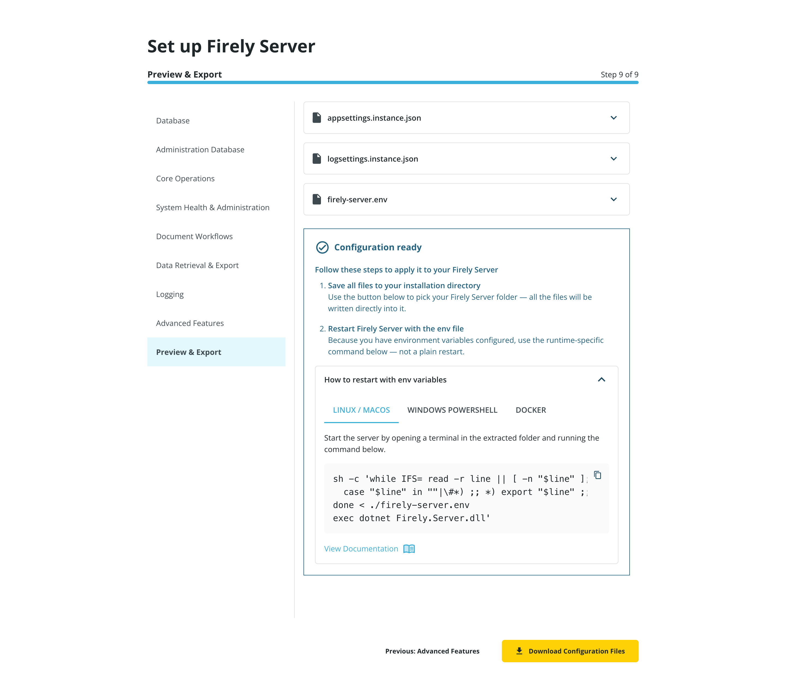

.. _vonk_getting_started:

===============
Getting Started
===============

The following pages will provide you with the first stepping stones when starting to work with Firely server.
You can install Firely Server locally in a matter of minutes for testing purposes.

.. _yellowbutton:

If you are interested in using a project on `Simplifier <https://docs.fire.ly/projects/Simplifier/>`_ for your conformance resources, you can also quickly spin up a Firely Server instance with the content of this project already loaded. For more information how to do this please see :ref:`Use Firely Server with your Simplifier artifacts <simplifier_docs:simplifier_firely_server>`.

.. _vonk_basic_installation:

Basic installation
------------------

.. note::
	Firely Server can run on all operating systems that support .NET. If your OS does not support .NET or if you want to use Docker,
	please look at the :ref:`use_docker` section.

If you want to start using the standard Firely Server in your local environment, follow the steps on this page to install
and run the server. |br|

1.	Sign up for an `evaluation license <https://fire.ly/firely-server-trial/>`_. You will receive an email with the license file as well as a link to the `download page <https://downloads.fire.ly/firely-server>`_ where you can download the Firely Server binaries with the version of your choosing.

2.	Extract the downloaded files to a location on your system, for example: :code:`C:\FirelyServer`. We will call this the
	working directory.

3.	Put the license file in the working directory.

4.	In the working directory create a new JSON file and name it ``appsettings.json``.
	You will use this file for settings that you want to differ from the defaults in ``appsettings.default.json``.
	For more background on how the settings are processed, see :ref:`configure_appsettings`.

5.	Open ``appsettings.json``, copy the ``LicenseFile`` setting from ``appsettings.default.json`` to it and change this property to the name of your license file. For example:
	::

		{
		  "License": {
			"LicenseFile": "firelyserver-trial-license.json"
		  }
		}

6. You can further configure Firely Server by adjusting the ``appsettings.json``. The section :ref:`vonk_setup_FS` explains possible configuration settings.

.. _vonk_run:

Running Firely Server
---------------------

.. important::

	The next step assumes you have a .NET environment installed. If not, please
	`download and install <https://dotnet.microsoft.com/en-us/download/dotnet/10.0>`_ **ASP.NET Core Runtime 10.x.xx Hosting Bundle** before you continue.
	Choose the latest security patch to mitigate security issues in previous versions.

	Firely Server requires .NET 10 as of version 6.9.0. Older releases require
	`.NET 8 <https://dotnet.microsoft.com/en-us/download/dotnet/8.0>`_ (Firely Server 5.7.0 up to and including 6.8.x)
	or .NET 6 (Firely Server 5.6.x and older).

When you have completed your configuration changes, start the server.
Open a command prompt or Powershell, navigate to your working directory and execute:
::

	> dotnet .\Firely.Server.dll

.. |br| raw:: html

    

Access Firely Server
--------------------

Firely Server will by default run on port 4080 of the system. Check if Firely Server is running correctly, open a browser and navigate to :code:`localhost:4080`.

.. _getting_started_guided_setup:

Guided setup
---------------------------

When launching Firely Server for the first time with default configuration, a welcome screen displays the current status of four key components: Database backend, Authentication & SMART, HTTPS/TLS, and Audit logging. Items requiring attention (such as SQLite or unauthenticated endpoints) are flagged in amber.

You can proceed in one of two ways:

* **Set Up My Server:** Opens the guided setup wizard to generate custom configuration files.
* **Explore Default Configuration:** Closes the onboarding screen and launches the server using default settings (SQLite, unauthenticated over HTTP; recommended for testing only).

If you select **Explore Default Configuration** or haven't modified ``appsettings.instance.json`` yet, the home page will display a **Start Guided Setup** button so you can run the wizard at any time.

Using the setup form
^^^^^^^^^^^^^^^^^^^^

* **Navigation:** Use the left sidebar to jump between the 9 setup steps, or click *Next* / *Previous* at the bottom. The book icon next to step titles opens the relevant documentation.
* **Defaults & Reset:** Click *Reset To Default* to restore settings for the active step (unavailable on *Advanced Features* and *Preview & Export*).
* **Validation & Indicators:**

  * *Red dot:* Validation error that must be resolved before exporting.
  * *Amber warning:* Non-blocking warning (e.g., SQLite selection).
  * *Greyed-out switch:* Feature unavailable for your current license or database choice.

.. note::
   The guided setup generates configuration files without modifying the live server directly. Settings are applied only after downloading the generated files and restarting the server.

Exporting and applying configuration
^^^^^^^^^^^^^^^^^^^^^^^^^^^^^^^^^^^^

The final step, **Preview & Export**, shows generated configuration files containing only your customized settings:

.. list-table::
   :header-rows: 1
   :widths: 35 65

   * - File
     - Content
   * - ``appsettings.instance.json``
     - Customized server settings
   * - ``logsettings.instance.json``
     - Customized logging settings (if changed)
   * - ``firely-server.env``
     - Environment variables for sensitive values (if enabled)

**To apply your changes:**

1. Click **Download Configuration Files** (or **Download as ZIP**) and save them to your Firely Server root folder.
2. Restart Firely Server:

   * Standard setup: Perform a normal server restart.
   * With an ``.env`` file: Execute the platform-specific restart command displayed on the export screen (Linux/macOS, PowerShell, or Docker).

For manual configuration, see :ref:`configure_appsettings`.
To explore features, see :ref:`vonk_features`.